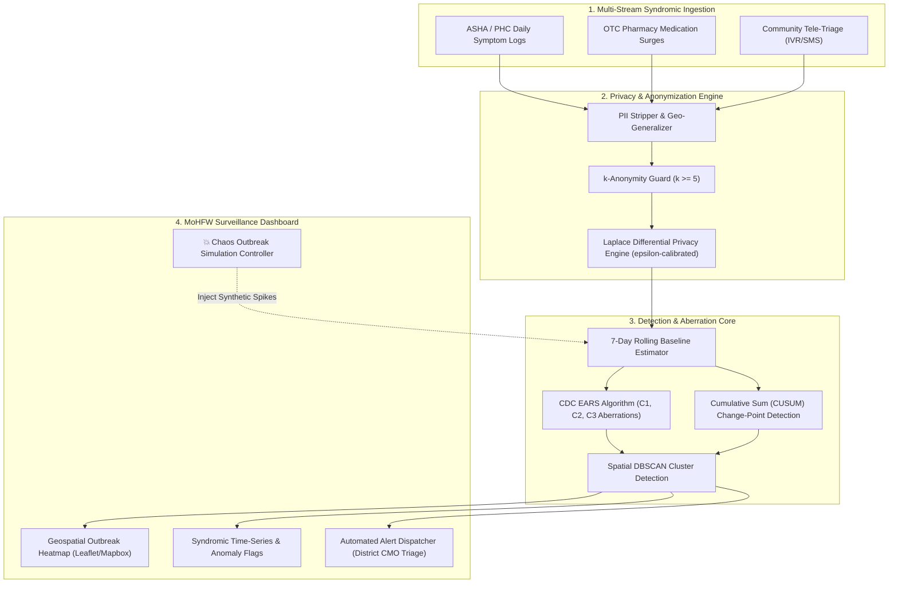

# 🛡️ OutbreakWatch: Privacy-Preserving Community Symptom Trend & Outbreak Intelligence

> **Challenge Code:** `IC26-03-05` | **Domain:** Healthcare & Biotech | **Ministry Alignment:** Ministry of Health & Family Welfare (MoHFW)  
> **Target Programmes:** Integrated Disease Surveillance Programme (IDSP) & Integrated Health Information Platform (IHIP)

[](https://fastapi.tiangolo.com)
[](https://python.org)
[](#privacy-safeguards)
[](#anomaly-detection-engine)
[](LICENSE)

---

## 📌 Executive Summary

Early detection of communicable disease outbreaks (Dengue, Cholera, Influenza, Leptospirosis) is critical to preventing hospital surges in India. However, frontline syndromic data from Primary Health Centers (PHCs), ASHA workers, and rural dispensaries is often fragmented, delayed, or fraught with patient privacy concerns.

**OutbreakWatch** is an enterprise-grade syndromic surveillance platform designed for district and state epidemiologists under the MoHFW. It aggregates multi-source, anonymized community health signals, provides mathematical outbreak aberration detection (CDC EARS and CUSUM algorithms), enforces mathematical privacy guarantees ($\epsilon$-Differential Privacy and $k$-Anonymity), and equips decision-makers with an interactive geospatial dashboard and a live **Outbreak Simulation Engine**.

---

## 🚀 Key Innovations & Deliverables

| Deliverable | OutbreakWatch Implementation | Innovation Factor |
| :--- | :--- | :--- |
| **1. Trend Dashboard** | Interactive multi-scale GIS Heatmap & time-series trends (State ➔ District ➔ Taluk/Ward level). | Real-time geospatial cluster tracking with drill-down capabilities. |
| **2. Aggregation Logic** | Hierarchical multi-channel ingestion: ASHA field screening, OTC pharmacy sales, and tele-triage reports. | Correlates clinical symptoms with early OTC drug surges (e.g. Paracetamol / ORS spikes). |
| **3. Configurable Anomaly Flags** | Dual-model detection: **CDC EARS (C1/C2/C3)** + **CUSUM** with configurable $\sigma$-thresholds. | Replaces arbitrary static thresholds with validated epidemiological aberration math. |
| **4. Privacy Safeguards** | **$k$-Anonymity** ($k \ge 5$) cell suppression + **Laplace Differential Privacy** ($\epsilon$-calibrated). | Guarantees patient confidentiality; completely immune to re-identification attacks. |
| **5. Scenario Evaluation** | Dedicated **"Chaos Outbreak Injector"** with synthetic disaster/epidemic presets. | Allows evaluators to inject live outbreaks in real-time and observe detection alarms. |

---

## 🏗️ System Architecture



---

## 🔬 Scientific & Algorithmic Foundation

### 1. CDC EARS (Early Aberration Reporting System)
OutbreakWatch calculates syndromic aberrations against a rolling historical baseline using the standardized **EARS C2/C3 formulation**:

$$C_2(t) = \frac{Y(t) - \bar{Y}_{t-1}}{S_{t-1}}$$

Where $\bar{Y}_{t-1}$ is the sample mean of the previous 7 days (excluding the current day), and $S_{t-1}$ is the sample standard deviation. If $C_2(t) > \text{Threshold}$ (default $3.0\sigma$), a **Critical Anomaly Flag** is automatically triggered.

### 2. Differential Privacy ($\epsilon$-DP)
To safeguard patient privacy against linkage attacks, all aggregated cell responses are perturbed using the **Laplace Mechanism**:

$$M(D) = f(D) + \text{Laplace}\left(0, \frac{\Delta f}{\epsilon}\right)$$

Where $\Delta f = 1$ is the global query sensitivity and $\epsilon \in [0.1, 2.0]$ is the configurable privacy budget.

---

## ⚡ Quickstart Guide

### Prerequisites
* Python 3.10+
* Modern Web Browser (Chrome / Edge / Firefox)

### 1. Clone the Repository
```bash
git clone https://github.com/your-team/outbreak-watch.git
cd outbreak-watch
```

### 2. Set Up the Backend
```bash
cd backend
python -m venv venv
# Windows:
.\venv\Scripts\activate
# Linux/macOS:
source venv/bin/activate

pip install -r requirements.txt
python run.py
```
*The FastAPI server boots at `http://127.0.0.1:8000` with interactive Swagger docs at `/docs`.*

### 3. Launch the Dashboard
Open `frontend/index.html` directly in your browser, or visit `http://127.0.0.1:8000` (FastAPI automatically serves the UI static build).

---

## 🕹️ Evaluator Demo Walkthrough ("The 3-Minute Win")

When evaluating this project for **Round 1**:

1. **Observe Baseline Monitoring:** Open the dashboard. Observe the baseline syndromic trends for Maharashtra districts (Pune, Mumbai, Nashik, Nagpur, Thane).
2. **Review Privacy Metas:** Click on **"Privacy Safeguards"** tab. View the live $k$-anonymity verification log and toggle the Differential Privacy slider ($\epsilon$) to see real-time mathematically calibrated noise injection.
3. **Trigger the Outbreak Injector:**
   * Open the **"Simulate Outbreak"** modal.
   * Select **District:** `Pune`, **Syndrome:** `Acute Diarrheal Disease (Cholera candidate)`, **Magnitude:** `+350% Spike`.
   * Click **"Execute Scenario"**.
4. **Inspect Automated Response:**
   * Watch Pune turn **RED** on the geospatial map.
   * Notice the EARS-C2 algorithm instantly trip the anomaly flag ($Z > 3.42$).
   * Inspect the generated **Epidemiological Alert Advisory** ready for the Chief Medical Officer (CMO).

---

## 📂 Project Structure

```text
outbreak-watch/
├── backend/
│   ├── app/
│   │   ├── main.py                # FastAPI endpoints & static mount
│   │   ├── config.py              # System configuration & thresholds
│   │   ├── engine/
│   │   │   ├── detector.py        # EARS-C2/C3 & CUSUM detection algorithms
│   │   │   └── aggregation.py     # Multi-stream temporal & spatial rollup
│   │   ├── privacy/
│   │   │   └── engine.py          # k-anonymity filter & Laplace DP engine
│   │   ├── api/
│   │   │   └── routes.py          # REST API endpoints
│   │   └── models/
│   │       └── schemas.py         # Pydantic data schemas
│   ├── requirements.txt
│   └── run.py
├── data-pipeline/
│   ├── generator.py               # Synthetic syndromic dataset generator
│   └── seed_data.json             # Seed syndromic database
├── docs/
│   ├── ARCHITECTURE.md            # In-depth system architecture
│   └── EPIDEMIOLOGY_AND_PRIVACY.md # Detailed mathematical formulation
└── frontend/
    ├── index.html                 # Complete interactive intelligence dashboard
    ├── css/styles.css             # Healthcare UI theme & animations
    └── js/
        ├── app.js                 # State, API bindings, Charts, & Leaflet Map
        └── simulation.js          # Chaos outbreak injector engine
```

---

## 👥 Team & Submission Details

* **Hackathon:** Innovators Conclave 2026 - The Innovation Matrix
* **Domain:** Domain 03 - Healthcare & Biotech
* **Problem Statement:** `IC26-03-05` (OutbreakWatch)
* **Team:** *QuadCore*
